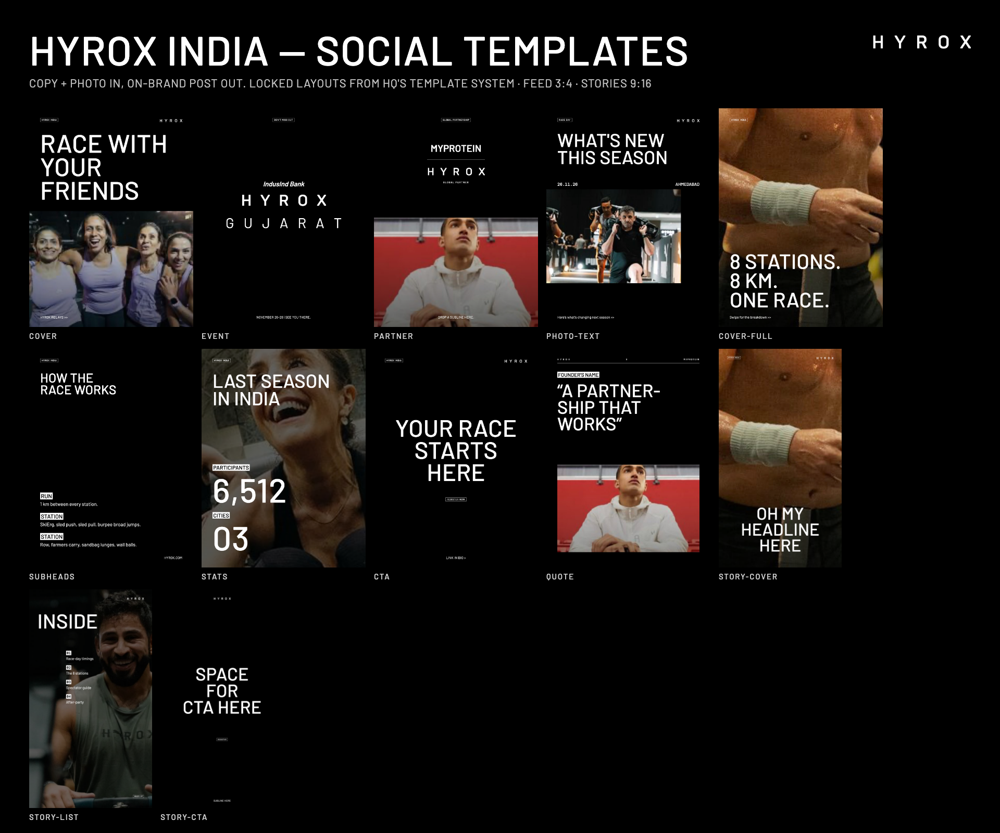

# HYROX India Marketing Kit

Everything the HYROX India team needs to make on-brand social posts with Claude, in one install.

> **Not technical? Start with [START-HERE.md](START-HERE.md).** Three steps, one sentence to paste, and Claude sets everything up for you.
>
> This is **version 1**. It keeps improving with your feedback, so tell us what's missing.



## What's inside

| Kit | What it is | Use it for | Cost |
|---|---|---|---|
| **HYROX India Social** (`hyrox-india-social/`) | HQ's *Social Templates Local* system turned into a Claude skill: locked layouts, HYROX logotype, type and colour rules, all 65 template pages as reference. | Feed posts (3:4), carousels and stories (9:16): covers, race news, partners, quotes, stats, schedules, CTAs. | Free |
| **Marketing Kit** (`marketing-kit/`) | 79 of the best marketing skills, compiled from GitHub and the frameworks top AI teams use. | Hooks and copy, ad variants, image-to-video, Reels, captions, brand checks. | Media steps use credits |
| **Higgsfield AI** (from [higgsfield-ai/skills](https://github.com/higgsfield-ai/skills)) | Higgsfield's official skills: 30+ image/video models, Soul ID, product photoshoots, thumbnails. | Generated imagery and video when you have no photo or footage. | Higgsfield account |

**The workflow:** copy → HYROX template (cover → content → finisher) → PNG posts → video with the Marketing Kit or Higgsfield when needed.

**→ Prompt templates for every format: [WORKFLOWS.md](WORKFLOWS.md)**

## The HYROX rule (built in)

**Make it yours. Keep it HYROX.** You can replace copy, swap imagery, pick text styles and combine templates.
You can't move locked elements, change fonts, colours or layouts, or invent new layouts. The skill follows this:
if copy is too long it tells you to shorten it instead of shrinking the text, and if no template fits it says so
(→ request a new one from HQ on Monday).

## Set up (once, about 5 minutes)

Use **Claude Code**, or the **Code** tab in the Claude desktop app. You also need **Google Chrome** installed (posts render on your computer).

**Option A: install everything (recommended).** In Claude Code:

```
/plugin marketplace add arth6025/hyrox-india-marketing-kit
/plugin install hyrox-india-social@hyrox-india
/plugin install marketing-kit@hyrox-india
/plugin install higgsfield@hyrox-india
```

Restart Claude Code.

**Option B: Claude app upload.** Download [`downloads/hyrox-india-social.zip`](downloads/hyrox-india-social.zip) and [`downloads/marketing-kit.zip`](downloads/marketing-kit.zip),
then **Customize → Plugins → Add → Upload plugin** for each.

**Higgsfield** (only if you'll generate images/video with it): install their CLI and sign in once:

```bash
curl -fsSL https://raw.githubusercontent.com/higgsfield-ai/cli/main/install.sh | sh
higgsfield auth login
```

**Marketing Kit media** (image-to-video, Reels): the first time, Claude shows a **Connect** button. Sign in to the workspace Arvind shares.

**Fonts:** HYROX's typeface is **Brutal Type** (licensed). If it's installed on your computer, posts use it automatically.
If not, they use **Barlow**, the closest free match. Brutal Type is not included in this repo.

**Check it works:** new chat → *"HYROX post: RACE WITH YOUR FRIENDS"* → you get a finished image.

## Use it

Start with **"HYROX"** and paste your copy:

- *"HYROX post: RACE WITH YOUR FRIENDS. Subline: HYROX RELAYS >>. Use this photo."* (attach a race photo)
- *"HYROX carousel from this copy: …"*
- *"HYROX story set for race day in Mumbai: inside, schedule, CTA."*
- *"HYROX partner post: Myprotein, Global Partner."* (attach their logo)
- *"Animate this HYROX post into a 5-second loop."* (Marketing Kit, shows the cost first)

Want a change? Say it plainly: *"use the centred cover"*, *"shorter headline"*, *"swap the photo"*, *"make a story version"*.

## Good to know

- **Use real race photos.** World posts: curated, editorial, elite. Local posts: event-led, race-driven, authentic. The sample photos in the skill are for drafts only.
- **Claude doesn't invent facts:** give it real dates, cities, partners and names.
- **Elite 15 quote templates** are reserved for Elite 15 athletes; others use the standard quote template.
- **Workout of the week:** the local handle replaces @HYROXWORLD.
- **City logos and new templates** come from HQ only.

## Troubleshooting

| Problem | Fix |
|---|---|
| `COPY TOO LONG` | The template's text size is fixed. Cut words. |
| Generic design, not HYROX | Start the message with "HYROX", check the plugin is on (**Customize → Plugins**), start a new chat. |
| "No Chrome/Chromium found" | Install Google Chrome. |
| Higgsfield says not signed in | Run `higgsfield auth login` in Terminal. |
| An old marketing skill shows up | `mkdir -p ~/.claude/skills-retired && mv ~/.claude/skills/{ad-creative,image,video,social} ~/.claude/skills-retired/` |

## Repo map

```
README.md          ← you are here
WORKFLOWS.md       ← prompt templates for every format
overview.png       ← every HYROX template, rendered
downloads/         ← zips for the Claude app upload
hyrox-india-social/skills/hyrox-india-social/
  SKILL.md                    ← how Claude uses the templates
  references/brand.md         ← HYROX rules: colour, type, logos, photography
  references/templates.md     ← every template, its PDF page, its fields
  assets/reference/           ← all 65 HQ template pages, as images
  scripts/make.py             ← brief → PNG renderer
marketing-kit/     ← 79 marketing skills (see CATALOG.md)
.claude-plugin/    ← makes this repo installable with /plugin (also pulls Higgsfield from GitHub)
```

Built by peakst8 for HYROX India. Questions? Ask Arvind.
